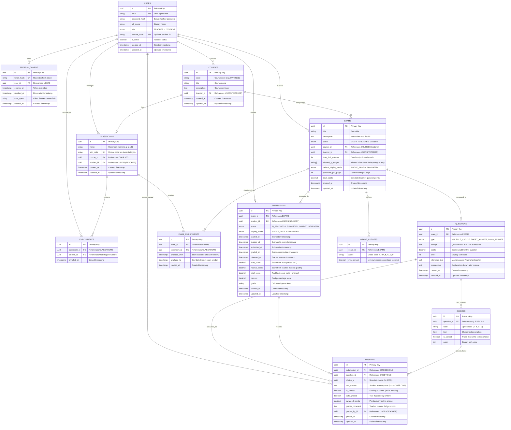

# 🗄️ Entity Relationship Diagram (ER Diagram)
### ระบบสอบออนไลน์ (Education / Exam System)

เอกสารนี้แสดงแบบจำลองฐานข้อมูลเชิงสัมพันธ์ (Relational Database Design) สำหรับจัดเก็บข้อมูลบน **PostgreSQL** โดยรองรับระบบข้อสอบ 3 ประเภท, การแยกบทบาทครู-นักเรียน, การจัดห้องเรียน, เกณฑ์ตัดเกรด, และการตรวจข้อสอบแบบ Hybrid (Auto + Manual)

---

## 1. Mermaid ER Diagram

---

## 2. พจนานุกรมข้อมูล (Data Dictionary & Entity Specifications)

### 2.1 ตาราง `users` (ผู้ใช้งานในระบบ)
เก็บข้อมูลทั้งครู (Teacher) และนักเรียน (Student) โดยแยกสิทธิ์ด้วยฟิลด์ `role`
- **id** (`UUID`, PK): ไอดีประจำตัวผู้ใช้
- **email** (`VARCHAR(255)`, UNIQUE, NOT NULL): อีเมลที่ใช้เข้าสู่ระบบ
- **password_hash** (`VARCHAR(255)`, NOT NULL): รหัสผ่านที่เข้ารหัสด้วย bcrypt
- **full_name** (`VARCHAR(150)`, NOT NULL): ชื่อ-นามสกุล
- **role** (`ENUM('TEACHER', 'STUDENT')`, NOT NULL): บทบาทของผู้ใช้งาน
- **student_code** (`VARCHAR(50)`, UNIQUE, NULLABLE): รหัสนักเรียน (กำหนดโดยครู หรือระบุตอนสมัคร)
- **is_active** (`BOOLEAN`, DEFAULT `true`): สถานะการเปิดใช้งานบัญชี

### 2.2 ตาราง `courses` & `classrooms` & `enrollments` (รายวิชาและห้องเรียน)
- **courses**: รายวิชาหลักที่ครูเป็นผู้สอน (เช่น รหัส MATH-M4 วิชาคณิตศาสตร์ ม.4)
- **classrooms**: ห้องเรียนย่อยภายใต้รายวิชา (เช่น ห้อง ม.4/1, ม.4/2) มี `join_code` ให้นักเรียนกรอกเพื่อเข้าห้อง หรือครูใช้ปุ่ม **"+" เพิ่มนักเรียน** เข้าห้องได้โดยตรง
- **enrollments**: ความสัมพันธ์ N:M ระหว่างนักเรียนกับห้องเรียน พร้อม constraint `UNIQUE(classroom_id, student_id)` เพื่อป้องกันการลงทะเบียนซ้ำ

### 2.3 ตาราง `exams` & `exam_assignments` (ชุดข้อสอบและการมอบหมาย)
- **exams**: ชุดข้อสอบที่ครูสร้างขึ้น ระบุประเภทเวลาสอบ (`time_limit_minutes`), โหมดแสดงผลเริ่มต้น (`default_display_mode`: `SINGLE_PAGE` หรือ `PAGINATED`), รายการ IP ที่อนุญาตให้เข้าทำข้อสอบ (`allowed_ip_ranges` — ว่าง = ไม่จำกัด) และสถานะชุดข้อสอบ (`DRAFT`, `PUBLISHED`, `CLOSED`)
- **exam_assignments**: ตารางเชื่อมระหว่างข้อสอบกับห้องเรียน ช่วยให้ข้อสอบ 1 ชุดสามารถมอบหมายให้หลายห้องเรียนได้ และกำหนดช่วงเวลาสอบ (`available_from`, `available_to`) แยกตามห้องได้

### 2.4 ตาราง `questions` & `choices` (โจทย์ข้อสอบและตัวเลือก)
- **questions**: รองรับโจทย์ 3 ประเภทตามความต้องการ:
  1. `MULTIPLE_CHOICE` (ปรนัย): มี choices ให้เลือก 1 ข้อ
  2. `SHORT_ANSWER` (คำตอบสั้น): นักเรียนพิมพ์คำตอบสั้น โดยครูสามารถระบุ `reference_text` เป็นแนวทางการตรวจ
  3. `LONG_ANSWER` (คำตอบยาว / เรียงความ): นักเรียนเขียนตอบขนาดยาว มี `reference_text` และเกณฑ์ประเมิน
  - มีฟิลด์ `explanation` สำหรับเก็บคำอธิบายเฉลย ซึ่งระบบจะแสดงให้นักเรียนดูหลังครูกดปล่อยผลเท่านั้น
- **choices**: ตัวเลือกสำหรับข้อสอบปรนัย มี `is_correct` กำหนดข้อที่ถูกต้อง มี `UNIQUE(question_id, label)`

### 2.5 ตาราง `grade_cutoffs` (เกณฑ์ตัดเกรด)
- กำหนดเกณฑ์คะแนนขั้นต่ำ (เปอร์เซ็นต์) ของแต่ละเกรด เช่น:
  - เกรด `A` : `min_percent = 80.00`
  - เกรด `B+`: `min_percent = 75.00`
  - เกรด `B` : `min_percent = 70.00`
  - เกรด `C+`: `min_percent = 65.00`
  - เกรด `C` : `min_percent = 60.00`
  - เกรด `D+`: `min_percent = 55.00`
  - เกรด `D` : `min_percent = 50.00`
  - เกรด `F` : `min_percent = 0.00`

### 2.6 ตาราง `submissions` & `answers` (การทำข้อสอบและการตรวจ)
- **submissions**: ติดตามรอบการสอบของนักเรียน
  - สถานะรอบสอบ (`status`):
    - `IN_PROGRESS`: กำลังทำข้อสอบ
    - `SUBMITTED`: **ส่งแล้ว รอตรวจ** (ระบบตรวจปรนัยอัตโนมัติแล้ว แต่อัตนัยยังรอครูตรวจ)
    - `GRADED`: ครูตรวจอัตนัยครบแล้ว คะแนนรวมคำนวณเสร็จสิ้น
    - `RELEASED`: **ครูกดส่งผลไปให้นักเรียนแล้ว** (นักเรียนจึงจะสามารถเข้าดูผลและเฉลยได้)
  - `auto_score`: ผลรวมคะแนนปรนัยที่ตรวจโดยระบบ
  - `manual_score`: ผลรวมคะแนนอัตนัยที่ครูให้คะแนน
  - `total_score`, `percent`, `grade`: คะแนนรวม เปอร์เซ็นต์ และเกรดที่ได้รับ
- **answers**: คำตอบรายข้อของนักเรียน
  - `choice_id`: ตัวเลือกที่นักเรียนเลือก (กรณีปรนัย)
  - `text_answer`: ข้อความที่นักเรียนพิมพ์ตอบ (กรณีอัตนัย)
  - `is_correct`: ผลการตรวจ (`true`, `false`, หรือ `null` หากยังไม่ได้ตรวจ)
  - `awarded_points`: คะแนนที่ได้ในข้อนั้น
  - `grader_comment`: **หมายเหตุของครู** ระบุเหตุผลว่า "ผิดเพราะอะไร / ถูกเพราะอะไร" เพื่อเป็น Feedback ให้นักเรียน

---

## 3. สรุปความสัมพันธ์เชิงตรรกะ (Cardinality Summary)

| Entity 1 | Cardinality | Entity 2 | ความหมายทางธุรกิจ |
| :--- | :---: | :--- | :--- |
| `users (TEACHER)` | `1 : N` | `courses` | ครู 1 คนสอนได้หลายรายวิชา |
| `courses` | `1 : N` | `classrooms` | 1 รายวิชาแบ่งเป็นหลายห้องเรียนได้ |
| `classrooms` | `1 : N` | `enrollments` | 1 ห้องเรียนมีนักเรียนได้หลายคน |
| `users (STUDENT)` | `1 : N` | `enrollments` | นักเรียน 1 คนสังกัดได้หลายห้องเรียน |
| `users (TEACHER)` | `1 : N` | `exams` | ครู 1 คนสร้างชุดข้อสอบได้หลายชุด |
| `exams` | `1 : N` | `exam_assignments` | ข้อสอบ 1 ชุดมอบหมายให้หลายห้องเรียนได้ |
| `exams` | `1 : N` | `questions` | ข้อสอบ 1 ชุดประกอบด้วยโจทย์หลายข้อ |
| `questions` | `1 : N` | `choices` | ข้อสอบปรนัย 1 ข้อมีได้หลายตัวเลือก |
| `exams` | `1 : N` | `grade_cutoffs` | ข้อสอบ 1 ชุดมีเกณฑ์ตัดเกรดหลายระดับ |
| `exams` | `1 : N` | `submissions` | ข้อสอบ 1 ชุดมีนักเรียนส่งกระดาษคำตอบได้หลายคน |
| `users (STUDENT)` | `1 : N` | `submissions` | นักเรียนส่งกระดาษคำตอบในข้อสอบแต่ละชุด |
| `submissions` | `1 : N` | `answers` | กระดาษคำตอบ 1 ใบมีคำตอบหลายข้อตรงตามโจทย์ |
