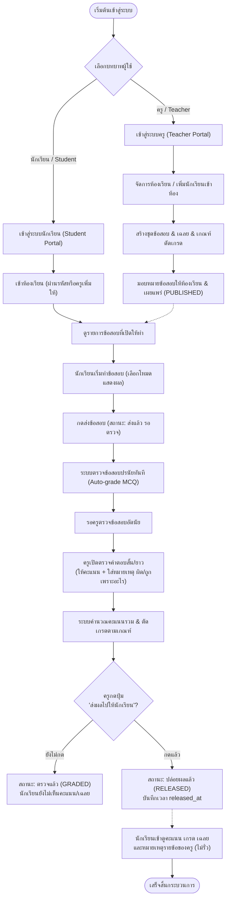
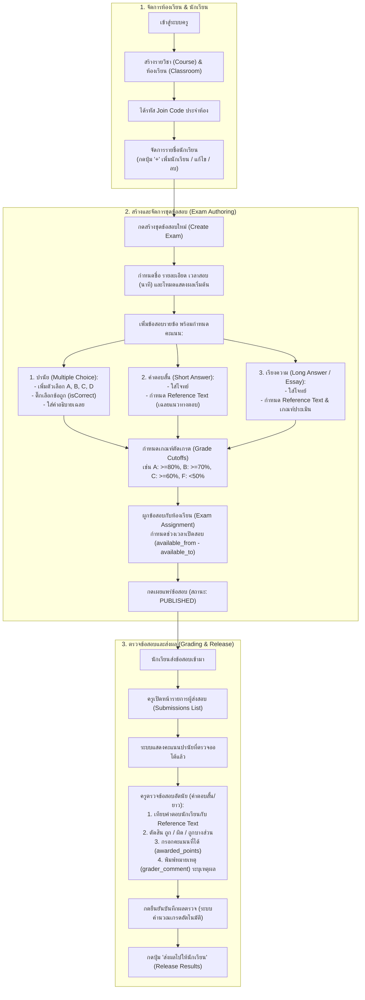
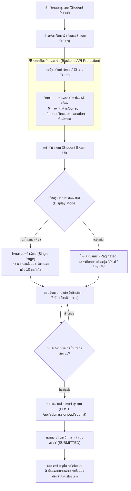
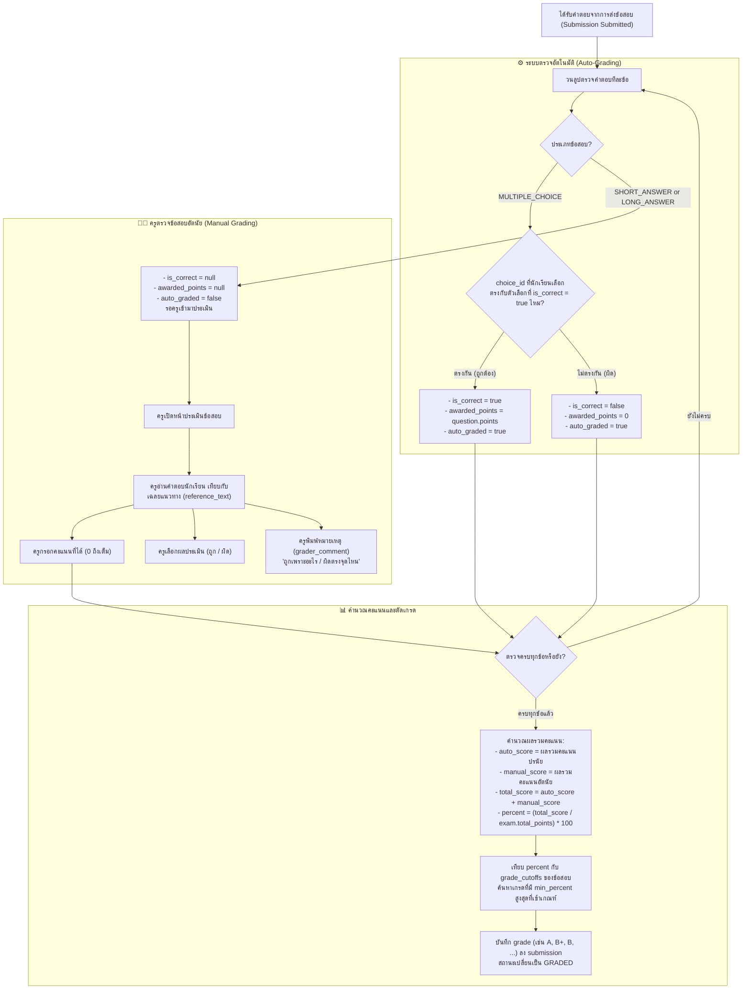
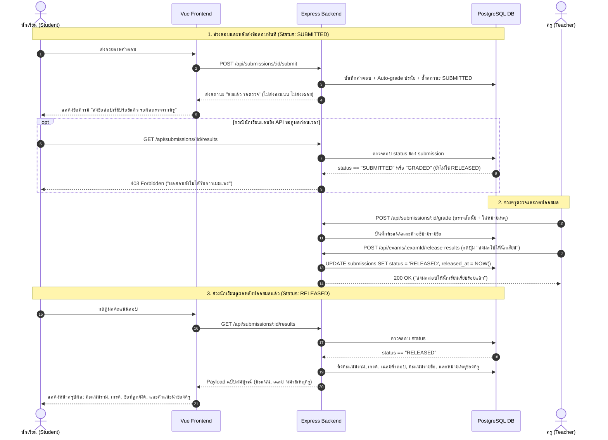

# 🔄 System Flowcharts (ผังการทำงานของระบบ)
### ระบบสอบออนไลน์ (Education / Exam System)

เอกสารนี้รวบรวม Flowchart และ Sequence Diagram ที่แสดงขั้นตอนการทำงานทั้งหมดของระบบ ตั้งแต่การยืนยันตัวตน, การจัดการห้องเรียน, การสร้างข้อสอบ, การทำข้อสอบ, การตรวจข้อสอบ (Auto + Manual), และการส่งผลให้นักเรียนดูเฉลยแบบไม่รั่ว

---

## 1. ภาพรวมการทำงานทั้งระบบ (End-to-End System Flowchart)

---

## 2. ขั้นตอนการทำงานของฝั่งครู (Teacher Workflow)

---

## 3. ขั้นตอนการทำข้อสอบของนักเรียน (Student Exam Taking Flow)

---

## 4. กลไกการตรวจข้อสอบและตัดเกรด (Grading & Cutoff Engine)

---

## 5. กระบวนการดูผลคะแนนแบบปลอดภัย ไม่รั่ว (Result Release & Security Flow)

