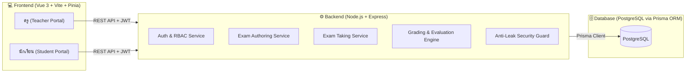

# 📚 เอกสารการออกแบบระบบสอบออนไลน์ (Online Examination System)

โฟลเดอร์นี้รวบรวมแบบแปลนโครงสร้างฐานข้อมูล (ER Diagram) และขั้นตอนการทำงานของระบบ (Flowcharts) ทั้งหมด โดยเขียนด้วย **Mermaid syntax** ซึ่งสามารถแสดงผลเป็นแผนภาพได้ทันทีบน GitHub, GitLab, VS Code และ Mermaid Live Editor

---

## 📁 สารบัญเอกสาร (Documentation Index)

| เอกสาร | รายละเอียด | รูปแบบไดอะแกรม | ลิงก์ไฟล์ |
| :--- | :--- | :--- | :--- |
| **1. ER Diagram & Data Dictionary** | แผนผังฐานข้อมูลความสัมพันธ์ระดับเอนทิตี (PostgreSQL + Prisma) พร้อมคำอธิบายตาราง ฟิลด์ และ Security Constraints | `erDiagram` | [ER_DIAGRAM.md](file:///D:/backend-m_wa-education-api/diagrams/ER_DIAGRAM.md) |
| **2. System Flowcharts** | ผังกระบวนการทำงานทุกส่วนของระบบ (Auth, Exam Authoring, Exam Taking, Auto/Manual Grading, Result Release) | `flowchart TD` & `sequenceDiagram` | [FLOWCHART.md](file:///D:/backend-m_wa-education-api/diagrams/FLOWCHART.md) |

---

## 🌟 สรุปภาพรวมสถาปัตยกรรมระบบ (System Architecture Summary)

---

## 🔒 จุดเด่นด้านความปลอดภัยของข้อมูล (Security & Anti-Leak Design)

1. **เฉลยไม่รั่วไหล (Zero Leak Question Payload):** เมื่อนักเรียนเข้าสอบ API จะกรองฟิลด์ `isCorrect`, `referenceText`, และ `explanation` ออกจาก JSON payload ทั้งหมด
2. **การป้องกันการดูผลก่อนเวลา (Release Gate):** นักเรียนจะไม่สามารถเรียกดูคะแนน ข้อที่ถูกต้อง หรือเฉลยได้จนกว่าสถานะข้อสอบจะถูกครูกดส่งผล (`RELEASED`)
3. **การส่งข้อสอบและการคำนวณคะแนนที่ Server-side:** ปรนัยตรวจอัตโนมัติที่ Backend ทันที ส่วนอัตนัยให้ครูตรวจพร้อมระบุคำอธิบายรายข้อ
